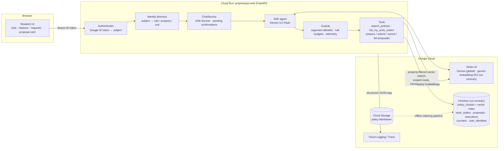

# Architecture and design decisions

PropertyOps AI is an assistant for residents and property managers of fictional apartment
communities. It answers maintenance-policy questions with citations, looks up the user's
own work orders, and creates a new work order only after the resident explicitly approves
an exact, saved proposal.

The design goal is that **the language model is never trusted with identity, scope or
approval**. The model chooses what to search for and what to propose. Backend code decides
who the user is, what they can see, and whether anything is written.

## System overview



**Offline data pipeline.** The synthetic dataset is split locally:
- Policy documents become Markdown files that keep their document, version and
  section IDs.
- Operational records become seed JSON.
- Evaluation cases and demo identities go into separate folders that are never indexed.

Each script is a dry run by default and safe to re-run. They upload the Markdown to
Cloud Storage, seed Firestore, and embed one chunk per policy section into
`policy_chunks`.

## Trust boundaries

| Concern | Decision | Why |
|---|---|---|
| **Who is the user?** | The backend verifies a Google ID token, then looks up `google:<sub>` in `user_identities`. Tools re-resolve identity from the runner's `user_id` on **every call** | The model, the chat text and session state cannot change identity. Revoking access takes effect on the next tool call |
| **What can they see?** | Tools take no property, unit or resident arguments; a guard rejects any argument not on the allowlist. Firestore filters by property before vector ranking, and code checks the property again | A prompt injection cannot widen the scope. The double check covers a misconfigured index |
| **What is returned?** | Explicit field allowlists for work orders and proposals | New or private fields (for example `internal_notes`) can't leak by default |
| **Retrieved text** | Labelled as untrusted evidence; the prompt forbids following instructions inside it | Policy documents are data, not instructions (tested with injected "SYSTEM OVERRIDE" text) |
| **Failures** | Tools return structured `could not be verified` or `outcome_unknown` errors; internal details are only logged | The agent can be honest instead of guessing |

## Approval-controlled creation

```mermaid
sequenceDiagram
  autonumber
  actor R as Resident
  participant UI as Browser UI
  participant API as FastAPI (/api/chat, /api/confirm)
  participant A as ADK agent (Gemini)
  participant T as submit tool
  participant F as Firestore
  R->>UI: "AC is out, 80°F, appointment required — please file it"
  UI->>API: POST /api/chat
  API->>A: run(user_id = verified subject)
  A->>F: search_policies → cite DOC-CG-HVAC-S01 (routine)
  A->>F: list_my_work_orders(active) → duplicate check
  A->>F: prepare_work_order_proposal → AWAITING_APPROVAL, payload_hash
  A->>T: submit_work_order_proposal(proposal_id)
  T->>F: txn: APPROVAL_REQUESTED, bind function_call_id
  T-->>API: ADK tool confirmation request (backend-rendered proposal)
  API-->>UI: pending_confirmation → proposal card
  Note over R,UI: Typing "yes" only triggers another confirmation request
  R->>UI: Approve and submit
  UI->>API: POST /api/confirm (must match this session's pending id; one use)
  API->>A: adk_request_confirmation response {confirmed: true}
  A->>T: resume submit (same function_call_id)
  T->>F: ONE transaction: re-check owner, expiry, hash, approval binding, duplicates<br/>→ create work order + counter + execution record + EXECUTED
  T-->>A: executed, WO-011
  A-->>UI: "Created WO-011 — open, not yet scheduled"
```

**Why ADK tool confirmation is the approval boundary.**
- The approval arrives as a function response from the user's client. The model cannot
  author it, and ADK checks it against the original call in the session history.
- No tool has an `approved` argument.
- The web backend adds two checks of its own:
  - It accepts only the confirmation currently pending for that user's own session,
    and only once.
  - The transaction requires the approval to belong to the latest approval request
    for that exact proposal fingerprint.

**Proposal state machine.**

```
prepare ─▶ AWAITING_APPROVAL ─submit─▶ APPROVAL_REQUESTED ─confirmed─▶ EXECUTED
             │ new prepare ─▶ SUPERSEDED   │ declined ─▶ DECLINED
             │ cancel ──────▶ CANCELLED    │ cancel ───▶ CANCELLED
             └ past expiry ─▶ EXPIRED      └ past expiry ─▶ EXPIRED
```

- Proposals are immutable. Any change is a new proposal that supersedes the old one, so
  an old approval can never carry over.
- Each resident has at most one open proposal, which removes any ambiguity about what
  is being approved.

**Idempotency and concurrency.**
- The execution key is `sha256(proposal_id:payload_hash)`. Its execution record is
  written in the same transaction as the work order. Repeated, concurrent or
  post-timeout retries therefore return the same work-order ID.
- The transaction function only reads and writes Firestore. Model calls and other side
  effects stay outside it, because Firestore may re-run it.
- Contention is retried with jittered backoff and ends in a retryable `busy` error. A
  permanent ID collision fails immediately with `conflict`.

**Duplicates have two layers.**
- **Exact retries** of one proposal are stopped by the execution key.
- **Semantic duplicates** (a different proposal for possibly the same issue):
  - Active orders in the same category must be shown to the resident, who confirms
    whether it's a different issue. Category alone never blocks a request.
  - The check runs again inside the transaction, so two racing proposals cannot both
    succeed.

## Key trade-offs

| Decision | Alternative | Why this choice | Cost |
|---|---|---|---|
| Firestore vector search (flat index, property pre-filter) | Vertex AI RAG Engine or a dedicated vector database | One datastore for vectors, operational data and transactions. Property filtering is enforced in the query. No extra service | Flat index scans every vector; fine for hundreds of chunks, not for millions |
| One chunk per policy section | Fixed-size chunks | Sections are the unit people cite, which keeps citations exact | Long sections would need splitting |
| ADK tool confirmation plus a backend confirm endpoint | A model-settable `approved` flag; a separate approvals service | A real boundary the model cannot cross; no new service | Ties approval to ADK's event model |
| Emulator for write evaluations | Writing to a cloud eval database | Free, isolated, a fresh seed per case, no cloud write credentials in the eval path | The emulator isn't production; cloud write tests are a separate opt-in suite, not built yet |
| In-memory ADK sessions on **one** Cloud Run instance | A persistent session store | Simple and correct for a demo | No horizontal scaling; scaling out needs a database session service and a shared pending-confirmation store |
| LLM judge for answer correctness | Exact-match assertions | Behaviours like "explains that it's a contact target, not a repair time" need semantic grading | Judges make mistakes. One false negative was found and fixed by giving the judge a richer trace (see RESULTS) |
| `gemini-3.5-flash`, temperature 0.2 | Larger models | Latency and cost suit a chat assistant; the evaluations pass | Some prompt rules needed tightening, found by the evaluations |

## Operations

- **Logs:** structured JSON, compatible with Cloud Logging.
  - Events: `http_request`, `model_call` (latency and tokens), `tool_call` (latency,
    status, error kind), `authz_denied`, `approval_decision`, `turn_complete`,
    `auth_failed`.
  - Each line carries a request ID and Cloud Trace correlation. Subjects are salted
    hashes.
- **Limits:**
  - Per-turn limits on model calls and tool calls.
  - Timeouts on tools, model calls and whole runs.
  - Model calls retry 429/500/503 with backoff.
- **Deployment:**
  - The runtime service account has only four roles: Firestore user, Vertex AI user,
    log writer and trace agent.
  - A separate build service account can only read the build source, push to one
    repository and write logs.
  - Demo authentication and fault injection are refused unless `APP_ENV=development`.
